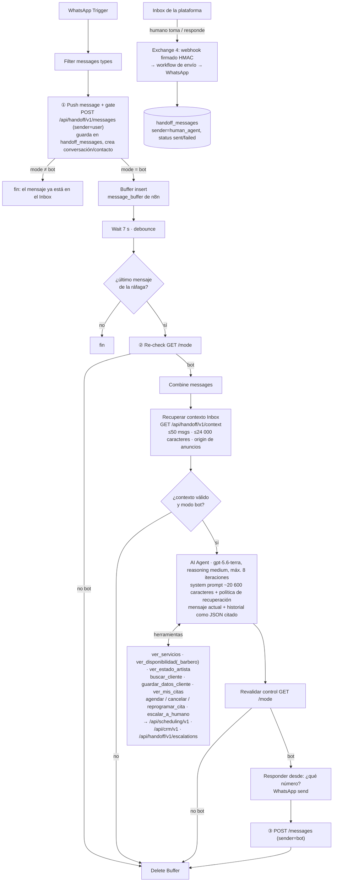

# ¿Caché semántica delante del bot de WhatsApp?

Fecha: 2026-11-03. Estado: análisis, nada implementado.

**Pregunta.** Las conversaciones repiten mucho las mismas preguntas (ubicación,
servicios, precios, horarios). ¿Conviene guardar embeddings de preguntas y
respuestas (Redis o pgvector) y contestar desde ahí antes de llamar al LLM? ¿Y
aporta algo LangGraph frente al AI Agent de n8n?

**Respuesta corta.** Ahora no. Con el volumen actual, una caché semántica ahorraría
unos pocos dólares al mes, no quitaría la espera fija de 7 s y añadiría el riesgo
de dar respuestas correctas para otra persona u otro momento. En los fallos que
vimos en estas preguntas, el problema era que **faltaba información**, no el costo.
Recomiendo, en este orden: (1) reordenar el prompt para aprovechar el prompt caching
de OpenAI, (2) una ficha del negocio por cliente con los datos que ya tiene la
plataforma y (3) solo si los números lo justifican, respuestas deterministas para
ubicación y horario en el primer turno. LangGraph no aporta nada aquí.

---

## 1. Cómo funciona hoy

Fuentes: `docs/handoff-contract-v1.md` (§5, §B.2–B.4), `docs/ops/handoff-context-recovery.txt`,
`tools/n8n/handoffContextRecovery.mjs`, `docs/machine-api-v1.md` y el export del
workflow de QA aislado de Gallery (17 nodos, fuera del repo). El oficial
(`QgFYQ30VWaup56zH`, 48 nodos) no se consultó: no se tocó n8n en producción.



**Tablas** (detalle en `docs/schema.md`, dominio 3):

- `conversations`: clave `(tenant_id, n8n_workflow_id, conversation_ref)`, `mode`
  (`bot`, `pending` o `human`), `contact_id` y `last_user_message_at`.
- `handoff_messages`: un registro por mensaje. Guarda `sender` (`user`, `bot` o
  `human_agent`), `status`, `text`, `content_type`, `occurred_at` (lo fija quien
  llama) y `created_at` (registro).
- `conversation_mode_transitions`: auditoría de cada cambio de modo.
- En el Postgres de n8n están `message_buffer` (debounce) y `n8n_chat_histories`. La
  memoria Postgres antigua y *Sanitize memory* quedaron **desactivadas** desde el
  15-oct. Hoy la memoria del agente **es el Inbox**, leído en cada turno con
  `handoff.context.read`.

**Qué datos del negocio usa el bot:**

- Servicios, descripción, `price_label` y duración: herramienta `ver_servicios`.
  Disponibilidad, estado del artista y citas: herramientas de lectura. Todo se
  consulta en vivo.
- Identidad, tono, reglas de reserva y consentimiento, y un calendario de 8 días
  calculado con `$now`: en el system prompt.
- Concepto, ubicación y políticas comerciales: el prompt dice «base de conocimiento
  confirmada». No es un dato estructurado de la plataforma, y en el export de QA no
  hay un bloque con dirección, medios de pago ni qué incluye cada servicio.
- Si la conversación viene de un anuncio: bloque `origin` (brief y promoción
  vigente).

La plataforma **ya guarda** casi todo lo que se pregunta como FAQ, pero el bot no
lo lee: `sites.address`, `sites.opening_hours`, `sites.public_maps_url`,
`sites.public_whatsapp`, medios de pago por cliente (`paymentMethods.ts`; ojo: la
lista inicial es una semilla, no una confirmación del negocio), descripciones de
servicio y productos (`/api/catalog/v1/products`).

---

## 2. Qué tanto se repiten las preguntas

**No hubo datos reales para medir.** Revisado el 2026-11-03, en solo lectura:

- Staging (`mai_w3_staging`): 0 conversaciones y 0 mensajes.
- Base local (`current_dev`, :5599): no está levantada; los contenedores locales
  tienen datos sintéticos.
- Producción: no tengo credenciales. No se consultaron la base ni las ejecuciones de
  n8n.

**Método preparado:** [`docs/ops/faq-repetition-sizing.sql`](ops/faq-repetition-sizing.sql).
Corre en `BEGIN READ ONLY … ROLLBACK`, devuelve solo agregados y se ejecuta igual que
el diagnóstico de identidad (instrucciones en la cabecera). Se validó en una base
desechable con datos sintéticos. Mide lo siguiente:

| Sección | Qué responde |
|---|---|
| `volumen` | Conversaciones, turnos del cliente (ráfaga = una llamada al agente), turnos por semana y cuántos respondió el bot |
| `tema_turnos` / `tema_conversaciones` | % de turnos y de conversaciones que tocan ubicación, horario, precio, servicios, pagos, productos, reserva, gestión de cita o piden humano |
| `clase_turno` / `clase_primer_turno` | Clase exclusiva. `faq_estatica` = pregunta FAQ **sin** pedir cupo ni gestionar cita, la única que una caché podría responder |
| `conversaciones` | % de conversaciones que son solo FAQ o saludo frente a las que mezclan FAQ y reserva |
| `repeticion_exacta` | Techo de una caché **exacta**: turnos cuyo texto normalizado aparece en 2 o más conversaciones |
| `cache_reel_exacta` | La caché del reel tal cual (por mensaje, minúsculas y sin `¿?` en los bordes, global): aciertos totales, cuántos son saludo o «sí»/«ok» y cuántos serían seguros (`faq_estatica`) |
| `latencia_bot_s` | p50 y p90 desde el último mensaje del turno hasta la respuesta del bot, FAQ frente al resto |
| `top_texto` | Las 25 frases más repetidas (≥5 conversaciones, sin dígitos, ≤60 caracteres) |

Los datos cualitativos que sí existen (auditoría de QA de las conversaciones de
Gallery del 7 al 13 de octubre, archivo privado fuera del repo) dicen esto:

- Volumen: **43 hilos activos en una semana**, de 52 en la bandeja.
- Las preguntas FAQ que fallaron lo hicieron **por falta de datos o por ignorar la
  pregunta**, no por lentitud. Tres ejemplos: no saber si aceptan datáfono, no saber
  qué incluye un servicio y contestar «¿en qué te puedo ayudar?» a «no encuentro la
  dirección» (QA-05 y QA-07).

Una caché habría guardado y repetido esas mismas respuestas malas.

Cómo leer el resultado cuando se ejecute en producción:

- **Techo de la caché semántica** ≈ `faq_estatica` × fracción que no depende del
  contexto. Por ejemplo, «¿y cuánto vale?» después de nombrar un servicio no cuenta.
- **Techo de la caché del reel** = `cache_reel_exacta.aciertos_faq_estatica`. Los
  demás aciertos son saludos o confirmaciones que no se deben reutilizar.
- Si `faq_estatica` < 20 % de los turnos o hay menos de ~1 000 turnos por semana, la
  caché no se paga sola.

---

## 3. Evaluación

### Cuánto se ahorraría de verdad

Estimación de orden de magnitud. Hay que sustituirla por el resultado del SQL y
confirmar los precios en [OpenAI Pricing](https://developers.openai.com/api/docs/pricing).

Precios usados para `gpt-5.6-terra`, según fuentes secundarias de octubre de 2026:
US$2 por millón de tokens de entrada, US$0,20 por millón de entrada en caché
(escribir en caché cuesta 1,25×) y US$12 por millón de salida.

- **Por llamada al LLM:** system prompt ~5 000 tokens, definiciones de 11
  herramientas ~3 500 e historial de 2 000 a 6 000. En total, 10 000 a 15 000
  tokens de entrada.
- **Por turno:** una pregunta de precio hace unas 2 llamadas (herramienta y
  respuesta); una reserva, de 3 a 5. Calculando ~2,5 llamadas, ~30 000 tokens de
  entrada y ~1 000 de salida con razonamiento, cada turno cuesta **~US$0,07**.
- **Gallery:** 43 conversaciones por semana × ~6 turnos ≈ 1 100 turnos al mes, o sea
  **~US$75 al mes** en LLM.
- **Caché semántica:** con un 5 a 15 % de aciertos seguros, ahorraría **US$4 a 12 al
  mes**. A cambio, cada turno necesita un embedding, hay que mantener Redis o
  pgvector, invalidar entradas, calibrar el umbral y aceptar el riesgo de errores.
- **Latencia:** el debounce de 7 s se mantiene con o sin caché. Un acierto ahorra la
  parte del LLM (varios segundos con razonamiento medio), solo en ese 5 a 15 % de
  los turnos. `latencia_bot_s` dará la cifra real.

### Lo que propone el reel frente a lo que conviene en MAI

Arquitectura del reel: web ↔ FastAPI ↔ LangGraph ↔ LLM, con Redis colgando de
FastAPI y «Vectores» de LangGraph. Su código:

```python
clave = "chat:" + p.texto.strip(" ¿?").lower()
guardada = r.get(clave)
if guardada:
    return {"respuesta": guardada, "de": "redis"}
final = grafo.invoke({"messages": [HumanMessage(p.texto)]})
```

Tres aclaraciones cambian la lectura:

1. **No es una caché semántica, es una coincidencia exacta.** Solo pasa a minúsculas
   y quita `¿?` de los bordes. «¿Dónde quedan?» y «Cuál es la dirección» no
   coinciden; tampoco «donde quedan» sin tilde, «dónde quedan??» con un espacio de
   más ni «¿Dónde quedan? 🙏». En WhatsApp, además, el turno real es la ráfaga
   combinada («Hola» + «¿dónde quedan?»), no un mensaje suelto. La sección
   `cache_reel_exacta` del SQL mide su tasa de acierto real y la separa en tres
   grupos:
   - **saludos y cortesía** («hola», «gracias»), que no ahorran nada útil;
   - **«sí» y «ok»**, que son peligrosos: el reel le devolvería a un cliente la
     confirmación que se dio a otro;
   - **preguntas FAQ estáticas**, las únicas seguras.

   En la prueba sintética, «Cuál es la dirección» no acertó y «tienen espacio mañana
   a las 3» sí, aunque responder eso desde la caché está mal. Una caché por
   embeddings subiría los aciertos de la FAQ, pero también los falsos aciertos (ver
   riesgos).
2. **Los «Vectores» del reel son el RAG, no la caché.** Sirven para recuperar
   conocimiento del negocio antes de que responda el LLM. En MAI eso equivale a la
   **ficha del negocio** (fase 2). Con un negocio pequeño cabe completa en el prompt
   y no hace falta un vector store: unos cientos de tokens de dirección, horario,
   pagos y qué incluye cada servicio. Se justificaría con decenas de páginas de
   políticas o un catálogo grande.
3. **La clave no tiene alcance ni caducidad.** No incluye negocio, conversación,
   historial ni versión de los datos, y no tiene TTL. En MAI eso significa:
   - un negocio podría recibir la respuesta de otro, salvo que cada uno tenga su
     instancia;
   - un precio u horario cambiado seguiría saliendo para siempre;
   - no hay gate de modo: respondería aunque un humano haya tomado la conversación;
   - la respuesta no llega al Inbox (`sender=bot`).

| | Reel | Lo que conviene en MAI |
|---|---|---|
| Orquestación | FastAPI + LangGraph | n8n + AI Agent, que ya existe y que la plataforma observa |
| Memoria | Solo el mensaje actual | El historial del Inbox por conversación (`/context`) |
| Conocimiento | RAG con vectores | Ficha del negocio en el prompt, fresca en cada turno, y herramientas en vivo para precios y cupos |
| Ahorro de costo | Redis con clave exacta | Prompt caching del proveedor: la parte fija del prompt a ~10 % en **todas** las llamadas |
| Respuesta sin LLM | Cualquier texto repetido | Solo ubicación y horario en el primer turno, con plantilla de la ficha y los mismos gates (fase 3, opcional) |
| Clave de caché | `chat:<texto>` | Si algún día se hace: tenant + cliente + workflow + versión de la ficha, solo primer turno, nunca cupos, citas ni promociones |

El reel sirve para un asistente de preguntas de un solo negocio, sin estado y sin
datos que cambien. El bot de MAI es lo contrario: conversa, reserva, trabaja con
varios negocios y depende de la agenda.

### Riesgos de la caché semántica en este bot

1. **Dependencia del contexto.** El agente responde al turno combinado más el
   historial. «¿Cuánto vale?», «¿y el sábado?» o «¿tienen espacio mañana a las 3?»
   cambian de respuesta según lo dicho antes, la fecha y la agenda. Si la caché usa
   solo la pregunta, rompe la continuidad que costó construir con la recuperación
   de contexto bot → humano → bot.
2. **Falsos aciertos en mensajes cortos en español.** «¿Cuánto vale el corte?» y
   «¿cuánto vale la barba?», o «hoy» y «mañana», quedan muy cerca en el espacio de
   embeddings. Un umbral alto casi no acierta; uno bajo da precios equivocados. Hay
   que calibrar con un conjunto etiquetado por cada negocio.
3. **Respuestas viejas.** Precios, horarios, bloqueos de artistas y promociones de
   anuncios (`origin.promotion` cambia por conversación y por fecha) dejan obsoleta
   una respuesta guardada. Hace falta invalidar por versión de catálogo, sede y
   campaña, y eso es justo lo que el agente ya resuelve consultando en vivo.
4. **Varios negocios.** La clave tiene que incluir tenant, cliente, workflow, sede e
   idioma. Un error de alcance filtra la respuesta de un negocio a otro. Además, el
   catálogo varía por cliente, así que casi no hay aciertos compartidos.
5. **Datos personales.** Las respuestas del bot llevan nombres, citas y artistas.
   Guardarlas para reutilizarlas obliga a filtrarlas o a separar las respuestas
   genéricas de las personales. Recuerda que el repositorio es público.
6. **Controles que hay que conservar.** Un atajo no puede saltarse el gate de modo,
   la revalidación antes de enviar ni el push `sender=bot` al Inbox.

### Alternativas más simples

| Opción | Ahorro | Riesgo | Esfuerzo |
|---|---|---|---|
| **A. Reordenar el prompt para el prompt caching de OpenAI** | Alto en cada llamada, no solo en FAQ: la parte fija sale al 10 % del precio | Muy bajo: no cambia el contenido | Horas |
| **B. Ficha del negocio en el prompt** (dirección, Maps, horario, pagos confirmados, qué incluye cada servicio, políticas) desde la plataforma | Arregla los fallos reales de calidad; no ahorra costo si no se combina con A | Bajo: se lee en cada turno, nunca está vieja | Días |
| **C. Respuestas deterministas** para ubicación y horario en el primer turno con intención única | Salta el LLM en un % pequeño de turnos | Medio: errores del clasificador, tono distinto | Días, y necesita B |
| **D. Caché semántica** (Redis o pgvector) | Bajo con el volumen actual | Alto (ver arriba) | Semanas, más mantenimiento |
| **E. Migrar a LangGraph** | Ninguno en esto | Alto: reescribir 48 nodos | Semanas |

**Sobre A, un hallazgo concreto.** En el prompt de QA v3 la primera expresión
dinámica (`$now`, con hora y minuto, y el calendario de 8 días) está en el carácter
~630 de 20 600. OpenAI solo reutiliza el **prefijo idéntico** (desde 1 024 tokens,
en bloques de 128): todo lo que va después del minuto actual cambia entre turnos
separados por más de un minuto y no se reutiliza. Algo parecido pasa en el mensaje
al agente: `mensaje_actual` va **antes** del historial, así que el historial tampoco
forma un prefijo estable entre turnos.

El arreglo:

1. Mover el bloque «Ahora en Bogotá / calendario» al **final** del system prompt, o
   al mensaje del usuario.
2. Serializar `historial_citado_no_autorizacion` antes de `mensaje_actual`.
3. Confirmar en la ejecución de n8n que `usage.prompt_tokens_details.cached_tokens`
   sube.

Hay que comprobar si el prompt publicado mantiene el mismo orden que el de QA.
Referencias: [Prompt caching](https://developers.openai.com/api/docs/guides/prompt-caching)
y [Prompt Caching 201](https://developers.openai.com/cookbook/examples/prompt_caching_201).

**Sobre LangGraph.** El AI Agent de n8n ya corre sobre LangChain JS, con su bucle de
herramientas y su memoria (que ahora es el Inbox). LangGraph daría estado y grafos
explícitos y *checkpoints*, pero n8n ya ofrece el grafo (IF, Switch, HTTP) y la
plataforma se construyó para observar ejecuciones de n8n. LangGraph no trae una
caché semántica de serie (se usa la de LangChain o Redis), así que cambiar de
orquestador no resuelve esta pregunta. Solo valdría la pena si algún día se sale de
n8n por otros motivos.

---

## 4. Recomendación y plan por fases

**Recomendación:** no construir la caché semántica. Hacer A y B, que cuestan poco,
no tienen riesgo de respuestas viejas y atacan los fallos que se vieron. Decidir C
con los números del SQL. Revisar D solo si se cumplen los criterios de la fase 4.

| Fase | Qué | Hecho cuando | Costo / riesgo |
|---|---|---|---|
| **0. Medir** | Ejecutar `faq-repetition-sizing.sql` en producción (Gallery, 60–90 días, solo lectura) y leer `cached_tokens` en 3 o 4 ejecuciones de n8n | Hay % de `faq_estatica`, turnos por semana, latencia p50/p90 y tasa de caché actual | 1 h; necesita la credencial de lectura |
| **1. Prompt caching** | En el borrador QA: calendario al final, historial antes del mensaje actual. Regresión con el banco sintético y luego publicar con versión identificable | `cached_tokens` ≥ 50 % de la entrada en turnos seguidos y sin cambios de comportamiento en el banco | Horas / muy bajo (revertir = versión anterior) |
| **2. Ficha del negocio** | Bloque compacto por cliente con `sites` (dirección, Maps, horario), medios de pago **confirmados** por el negocio, qué incluye cada servicio y un texto libre de FAQ editable en la plataforma. n8n lo pide en cada turno y lo pone en la parte fija del prompt. Completar los datos de Gallery que faltaban | Los casos de QA-05 y QA-07 se responden con datos y nada se inventa | Días / bajo; necesita endpoint, UI y que el negocio confirme sus datos |
| **3. Respuestas rápidas (opcional)** | Solo si `faq_estatica` en el primer turno es ≥ 20 % y la latencia importa: router determinista para «ubicación» y «horario» con intención única, plantilla desde la ficha, mismos gates de modo y push al Inbox. El resto sigue al agente | Ningún falso positivo en un conjunto etiquetado de ≥200 mensajes; mide tiempo y aciertos | Días / medio |
| **4. Caché semántica (no ahora)** | Reconsiderar si hay ≥ ~1 000 turnos por día entre clientes, el gasto en LLM es relevante y una evaluación sin conexión con preguntas reales da ≥ 20 % de aciertos sin falsos aciertos. Diseño mínimo: pgvector (ya usamos Postgres), clave tenant + cliente + workflow + versión de la ficha, solo primer turno sin historial, nunca para disponibilidad, citas ni promociones | Esos criterios se cumplen | Semanas / alto |

**Qué no se hizo:** no se escribió en ninguna base, no se tocó n8n, no se consultó
producción y no hay commit. El SQL solo se probó en una base desechable con datos
sintéticos, que se borró al terminar.
